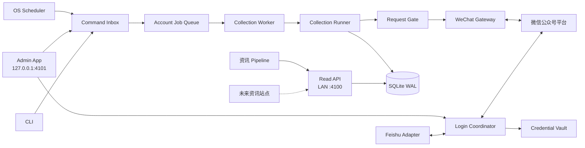
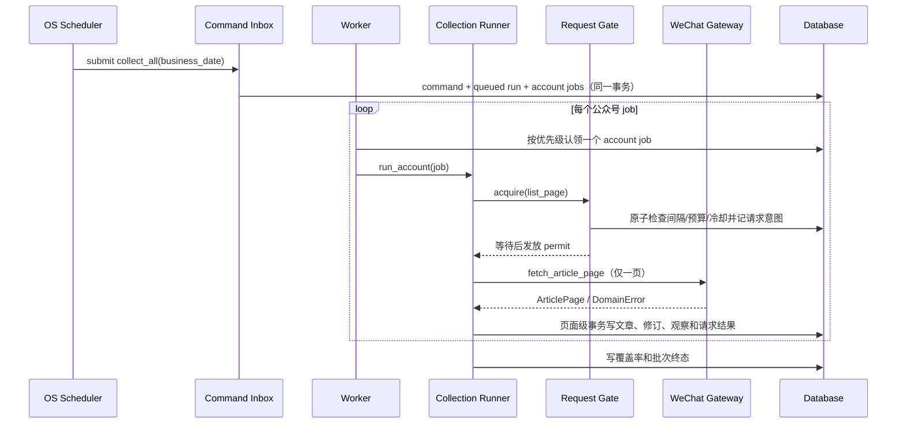
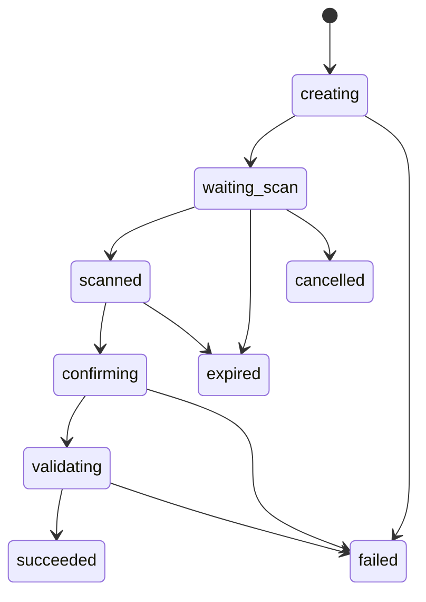

# 微信公众号文章列表采集系统总体设计

> **遗留设计：** 微信采集因上游频控不再作为生产路径。当前实现与新
> Pipeline 设计以 [docs/PUBLIC_LIST_INGESTION.md](docs/PUBLIC_LIST_INGESTION.md) 为准。

> 状态：核心采集、存储、Pipeline Read API、管理站点、加密凭据导入、部署机本机扫码和运维路径已实现；飞书二维码投递待实现<br>
> 读者：开发人员、代码审查者、接手开发的 AI Agent<br>
> 范围：约 15 个固定微信公众号，每日一次文章列表采集，不抓正文

## 0. 开始开发前

### 0.1 推荐阅读顺序

| 顺序 | 文档 | 解决的问题 |
|---:|---|---|
| 1 | 本文 | 系统为什么这样拆、哪些决策不能随意改变 |
| 2 | [IMPLEMENTATION_GUIDE.md](docs/IMPLEMENTATION_GUIDE.md) | 代码放哪里、按什么顺序开发、每阶段如何验收 |
| 3 | [DATA_AND_API_CONTRACTS.md](docs/DATA_AND_API_CONTRACTS.md) | 表、状态、事务、HTTP 接口的精确定义 |
| 4 | [ADMIN_UI.md](docs/ADMIN_UI.md) | 管理站点页面、交互和异常状态 |

文档索引见 [docs/README.md](docs/README.md)。若文档发生冲突，优先级为：数据/API 契约 > 本文锁定决策 > 实施指南 > 页面说明。

### 0.2 当前代码与目标的差距

当前实现已经具备：

- Alembic 管理的 SQLite WAL 数据库，文章事实、版本、观察记录、批次、作业、命令项、请求账本和事件分表保存。
- 所有公众号分页请求由单个 Worker 执行，逐请求持久化限频，支持 24 小时总量、单批次总量、随机间隔和 `200013` 全局冷却。
- 管理站点提交采集命令、管理账号、查看批次、文章、事件和请求诊断；凭据仅进加密 Vault。
- 面向 Pipeline 的 Bearer-token Read API，支持游标分页和最新定时批次质量判断。
- systemd Worker/API/Admin 服务与 `23:50` 定时入队示例，以及 SQLite 备份、恢复和完整性检查。

尚未实现：飞书二维码投递，以及旧 `0.1.0` 数据库的自动迁移。这些能力不能因设计文档已有接口就被当成已交付能力。

### 0.3 锁定决策

下列决策已经在需求讨论中确认。改动前应先更新设计文档并说明理由。

| 编号 | 决策 |
|---|---|
| D-01 | 不依赖 Docker；直接运行 Python 3.11+ 进程。 |
| D-02 | 只采集文章列表元数据，不抓正文，不使用 Playwright。 |
| D-03 | Pipeline 永远不触发微信采集，只读取已落库数据。 |
| D-04 | 每天约 `23:50` 提交一次采集命令，由操作系统调度器负责时间触发。 |
| D-05 | 采集器不按发布时间过滤文章；新鲜度过滤只在 Pipeline 统一处理。 |
| D-06 | 所有公众号搜索和文章分页请求全局串行，并逐请求经过 Request Gate。 |
| D-07 | `200013` 立即停止整个批次且不自动重试；`200003` 标记授权失效。 |
| D-08 | 扫码支持部署机本地页面和飞书远程发码，两者共用同一登录状态机。 |
| D-09 | 管理站点默认仅监听 `127.0.0.1`；远程扫码不依赖访问管理站点。 |
| D-10 | 当前使用 SQLite WAL；秘密凭据与业务数据库分离。 |
| D-11 | 文章事实、采集事实、Pipeline 加工和站点发布状态分开存储。 |
| D-12 | 管理页、CLI 和调度器都提交持久化命令，由同一个 Worker 执行内容请求。 |

## 1. 目标与非目标

### 1.1 目标

1. 稳定管理约 15 个固定公众号和一个微信公众号平台授权会话。
2. 每天串行采集文章列表，尽量用最少请求追到已知水位线。
3. 每个命令、批次、公众号、分页请求和入库结果均可追踪。
4. Pipeline 能读取文章，同时判断最近批次是否新鲜、完整或降级。
5. 运维人员无需查数据库或服务器日志即可完成常规管理。
6. 数据模型可支撑未来文章列表站点，无需重新抓取历史事实。

### 1.2 非目标

- RSS、正文抽取、LLM 摘要、报告生成和内容推送。
- 账号池、代理池、自动切号、UA 轮换或绕过微信频控。
- Pipeline 运行时现抓现用。
- 自动发现公众号和自动历史回填。
- 第一阶段的公网管理后台、多租户和复杂 RBAC。

## 2. 系统结构



### 2.1 三个运行面

| 运行面 | 唯一职责 | 允许写库 | 允许请求微信 |
|---|---|---:|---:|
| Collection | 消费命令、采集、频控、事务入库 | 是 | 是 |
| Read API | 向 Pipeline/站点提供只读投影 | 否 | 否 |
| Admin | 授权、配置和运维交互 | 配置/命令 | 仅通过应用模块 |

Read API 的任何 GET 都不能产生微信请求、刷新会话或修改最后请求时间。

### 2.2 核心模块

| 模块 | 深接口 | 隐藏的实现复杂度 |
|---|---|---|
| Command Inbox | `submit(command) -> command_id/run_id` | 幂等、排队、lease、崩溃恢复 |
| Account Job Queue | `claim_next() -> account_job` | 按公众号去重、人工优先、FIFO、公平性 |
| Collection Runner | `run_account_job(job) -> result` | 分页、水位线、事务、终态和结果回填 |
| Request Gate | `acquire(operation) -> permit` | 全局间隔、抖动、预算、冷却、原子竞争 |
| WeChat Gateway | `search_accounts`、`fetch_article_page` | 非公开协议、解析、错误归一化 |
| Login Coordinator | `start`、`status`、`cancel` | 扫码状态机、轮询、验证、原子换证 |
| Credential Vault | `load`、`replace_after_validation` | Keychain/加密文件、版本和权限 |
| Repository | 领域化读写方法 | SQL、migration、事务和约束 |
| Read Model | `pipeline_articles`、`latest_batch` | 稳定排序、游标、质量计算和字段白名单 |

接口定义和目标包结构见 [IMPLEMENTATION_GUIDE.md](docs/IMPLEMENTATION_GUIDE.md)。

## 3. 内容采集闭环

### 3.1 命令与批次

所有内容操作先写入 `collection_commands`：

- `collect_all`：日常全量公众号计划。
- `collect_account`：人工采集单个公众号。
- `collect_selected`：前端选择一个或多个公众号定点采集。
- `search_account`：人工搜索公众号。
- `backfill_account`：显式历史回填，第一阶段可不实现。

提交 `collect_*` 命令时，在同一事务创建状态为 `queued` 的 `collection_run`，并为目标关联公众号级 `account_collection_job`。单实例 Worker 每次只认领一个 job；一个 job 内仍按相同策略读取 1-3 页。HTTP 请求不等待任务完成。

定点采集采用以下去重规则：

- 公众号 job 正在 `running`：忽略本次目标，返回 `ignored_already_running`。
- 公众号 job 已经 `queued`：不创建重复 job，当前批次关联该 job，并将其提升为人工优先，返回 `promoted_existing_job`。
- 公众号没有活动 job：创建 `queued` job，返回 `enqueued`。
- 当前正在执行的 job 不被抢占；人工 job 只影响下一次认领顺序。

前端一次选择多个公众号时只提交一个 `collect_selected` 命令，但数据库为每个目标记录独立处理结果。定时批次也可以关联已经存在的 queued job；job 完成后将同一结果回填给所有关联批次，不会重复请求微信。

### 3.2 每日执行流程



### 3.3 分页规则

每个公众号先取第一页。`count=5` 表示请求 5 个 `publish_list` 发布记录，每个发布记录的 `appmsgex` 可能展开出一篇或多篇文章，因此一页不等于固定 5 篇文章。展开后再依次判断：

1. 页面包含已知水位线：停止。
2. 返回的发布记录数小于 5：停止。
3. 展开后的文章全是新文章且未到 3 页：下一页重新经过 Request Gate。
4. 到 3 页仍未见水位线：保存已有数据，公众号标记 `page_limit_reached` 并告警。

分页参数是发布记录 offset：第一页 `begin=0,count=5`，第二页 `begin=5,count=5`，第三页 `begin=10,count=5`。正常情况下第二页不重复返回第一页，但请求间隔内若源列表新增、删除或重排，offset 可能产生重叠或遗漏。

为避免误判，job 开始时必须冻结“上次成功批次的水位线”，并维护本 job 的 `seen_article_ids`：

- 同一 job 前页已经见过的文章只做去重，不视为历史水位线。
- 只有命中 job 开始前冻结的水位线，才能按“已追到历史边界”停止。
- 页间重复写入请求账本和观察统计，但不重复创建文章或 observation。
- 满页且未命中冻结水位线时继续翻页；达到页上限仍未命中则标记 `page_limit_reached`。

首次添加公众号默认只取一页。任何历史回填必须显式触发，不能在“添加公众号”后自动开始。

### 3.4 频控不变量

| 控制 | 默认值 | 不变量 |
|---|---:|---|
| 并发 | 1 | 搜索和文章分页不能并发 |
| 最小间隔 | 240 秒 | 每一页都检查，不按公众号检查一次 |
| 额外抖动 | 30-90 秒 | 使用可注入随机源，测试可确定 |
| 每页发布记录数 | 5 | 兼容 `we-mp-rss` 的保守默认值，不代表微信官方上限 |
| 单公众号页上限 | 3 | 到达后不再继续 |
| 常规批次上限 | 45 | 15 个公众号 × 每号最多 3 页 |
| 滚动 24 小时硬上限 | 60 | 搜索、人工采集和定时分页共同计数，不在零点重置 |
| `200013` 冷却 | 6 小时起 | 当前批次停止，不在批次内重试 |

频控状态和请求意图必须在发出网络请求前持久化。进程崩溃留下的 `sent/unknown` 请求不能立即重发。

定点采集不拥有特殊频控通道：每一页仍等待 270-330 秒，仍受 3 页上限、滚动 24 小时 60 次上限和 `200013` 熔断约束。它的优势是只采选中的公众号，而不是等待整个 15 公众号计划。

`count=5` 来自上游实现经验。由于该接口没有公开稳定规格，修改为 10 前必须通过显式协议验证命令，在 Request Gate 下比较返回码、发布记录数、顺序和重复项；系统不得自动探测或在失败后反复试值。

### 3.5 计划公平性

定时批次按 `business_date % enabled_account_count` 对基础顺序做确定性轮转。这样若批次中途停止，不会长期只遗漏排序末尾的公众号。批次开始前把完整顺序写入 `collection_run_accounts`，未执行项保持 `not_started`。

## 4. 登录闭环

### 4.1 两种展码方式

| 方式 | 发起入口 | 二维码出现位置 | 是否需要内网穿透 |
|---|---|---|---:|
| 本机扫码 | `/admin/wechat-auth` | 部署机本地浏览器 | 否 |
| 飞书扫码 | CLI 或白名单飞书命令 | 指定飞书会话 | 否 |

两种方式只负责“如何交付二维码”，底层必须共用同一个 `Login Coordinator` 和登录会话记录。

### 4.2 状态机



登录不变量：

- 全系统最多一个活动登录会话；重复发起返回已有会话。
- 每个登录会话独占一个临时 `requests.Session`。
- 二维码、微信登录 UUID 不进入业务数据库，到期或成功后删除。
- 新凭据通过真实账号页验证成功后才原子替换旧凭据。
- 验证失败继续保留旧凭据。
- Cookie、token 不进入日志、HTTP 响应或飞书消息。
- 进程重启后活动二维码直接过期，不尝试恢复轮询。

扫码协议需要短间隔轮询，因此使用独立 `LoginSessionController`，不套用 240 秒内容 Request Gate，也不计内容请求预算。登录和内容 Worker 互斥：采集中不能发起登录，登录中内容命令保持 `queued`。

## 5. 数据与消费闭环

### 5.1 数据分层

| 数据域 | 核心实体 | 作用 |
|---|---|---|
| 配置 | `official_accounts` | 公众号主数据和启停状态 |
| 内容事实 | `articles`、`article_revisions` | 当前文章值和历史变化 |
| 采集事实 | `collection_runs`、`collection_run_accounts`、`collection_run_articles` | 批次覆盖和观察证据 |
| 请求控制 | `collection_commands`、`wechat_requests`、`request_control_state` | 排队、频控和请求账本 |
| 授权 | `wechat_login_sessions` + Credential Vault | 状态与秘密分离 |
| 运维 | `collection_events` | 管理站点可查询的脱敏事件 |
| 下游 | `article_enrichments`、`site_publications` | 未来 Pipeline/站点状态，不覆盖文章事实 |

公众号“删除订阅”使用归档语义：从后续计划和 Pipeline 后续结果中移除，但保留公众号、文章、批次和请求历史；重新添加同一公众号时恢复原记录，不创建重复账号。管理页面同时提供暂停、归档和恢复。已经进入 `running` 批次的计划是不可变快照，因此变更从下一批次生效。

字段、约束、索引和事务见 [DATA_AND_API_CONTRACTS.md](docs/DATA_AND_API_CONTRACTS.md)。

### 5.2 Pipeline 规则

Pipeline 只调用 Read API。它不持有微信 Cookie，不调用公众号搜索、更新或文章详情接口。

若 Pipeline 在 `7 月 9 日 08:23` 运行，时间窗口为：

```text
published_from   = 7 月 8 日 00:00:00 Asia/Shanghai
published_before = 7 月 10 日 00:00:00 Asia/Shanghai
```

这是自然日窗口，不是滚动 24 小时。时间过滤应位于 Pipeline 统一过滤模块，微信 source adapter 不再自行过滤。

Read API 同时返回最近定时批次的状态、完成时间、覆盖率和缺失公众号。批次不存在、过旧、未完成或覆盖不足时，Pipeline 必须记录 source degradation，不能把它解释成“成功但 0 篇”。

### 5.3 容量结论

按 15 个公众号、每个每天 10 篇计算：每天新增约 150 篇，每年 54,750 篇，10 年约 547,500 篇。考虑文章、索引、采集观察、请求账本和少量 revision，10 年数据库保守估计约 3-8 GB。

该规模对正确建索引、使用游标分页的 SQLite 不构成性能压力。请求次数不能只按文章数推导，因为一个发布记录可能包含多篇文章。15 个公众号通常需要 15-45 次请求；按 270-330 秒实际间隔，批次约需 1.1-4 小时，实际值应由前几周的 `publish_record_count/article_count/page_count` 指标校准。

若单个公众号在 3 页发布记录内仍看不到旧水位线，必须标记 `page_limit_reached`、不推进水位线并提示显式回填，不能仅按文章篇数预判完整性。

数据库容量、保留策略、查询性能目标和迁移阈值以 [DATA_AND_API_CONTRACTS.md](docs/DATA_AND_API_CONTRACTS.md) 为准；前端大数据量规则以 [ADMIN_UI.md](docs/ADMIN_UI.md) 为准。

## 6. 错误与终态

| 条件 | 当前对象状态 | 批次动作 | 是否自动重试 |
|---|---|---|---:|
| 正常完成 | `completed` | 完成覆盖统计 | 否 |
| 页上限或可隔离的数据告警 | `partial` | 保存已有数据并继续计划 | 否 |
| 微信 `200013` | `rate_limited` | 立即停止并打开冷却 | 否 |
| 微信 `200003` | `session_expired` | 立即停止并提示授权 | 否 |
| 网络超时/连接失败 | `failed` | 保守停止批次 | 否 |
| 协议结构变化 | `protocol_changed` | 停止并保留脱敏摘要 | 否 |
| 运行锁已占用 | `rejected` | 不影响现有运行 | 否 |
| 计划项未执行 | `not_started` | 计入缺失和覆盖率 | 不适用 |

“空列表”不是错误，但必须结合有效微信响应、批次状态和公众号结果展示，不能只返回空数组。

## 7. 部署与调度

```text
Python 3.11+ virtualenv
  ├─ wechat-list-collector worker    单实例命令消费者
  ├─ wechat-list-collector admin     127.0.0.1:4101
  ├─ wechat-list-collector api       0.0.0.0:4100
  └─ wechat-list-collector enqueue   OS scheduler 每日调用
```

- Linux 用 systemd service + timer；macOS 用 launchd；Windows 用 Task Scheduler。
- 默认 `23:50` 提交，允许 `0-120` 秒启动抖动。
- 定时幂等键为 `(schedule_name, business_date)`。
- 错过任务可在次日 `06:30` 前补提交；之后只记录 `missed`。
- Read API 使用 `pipeline:read` Bearer token，并由局域网防火墙限制来源。
- Admin 默认仅 loopback，仍需管理员登录、CSRF 和审计。
- SQLite 开启 WAL、foreign keys、busy timeout；禁止多机共享打开数据库文件。
- 每日备份数据库和 migration 版本，定期做空环境恢复验证。

Docker 不是抓取机制的一部分。稳定性来自协议封装、请求控制、状态持久化和运维闭环，而不是容器。

## 8. 系统级验收标准

1. 15 个公众号的每一页请求都有 `wechat_requests` 记录和 Gate 等待证据。
2. 命中 `200013` 后剩余公众号全部为 `not_started`，冷却期无内容请求。
3. 本机页面和飞书都能完成扫码，且使用同一登录状态机。
4. 新授权验证失败不会覆盖旧凭据，日志和接口中不存在 Cookie/token。
5. 重复采集不重复创建文章；元数据变化产生 revision。
6. Pipeline 能读取自然日窗口文章和批次质量，并显式处理降级。
7. 管理站点能从批次追到公众号、请求页和文章。
8. Worker/Web/API 任一进程重启不会产生并发请求或重复定时批次。
9. 数据库可从备份恢复并通过 migration 与完整性检查。

具体阶段验收见 [IMPLEMENTATION_GUIDE.md](docs/IMPLEMENTATION_GUIDE.md)，页面验收见 [ADMIN_UI.md](docs/ADMIN_UI.md)。
