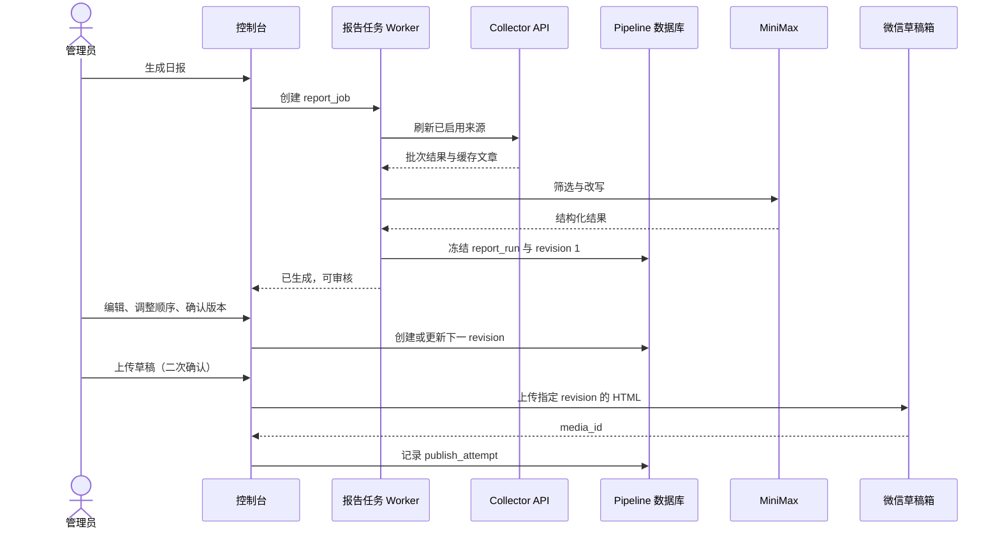
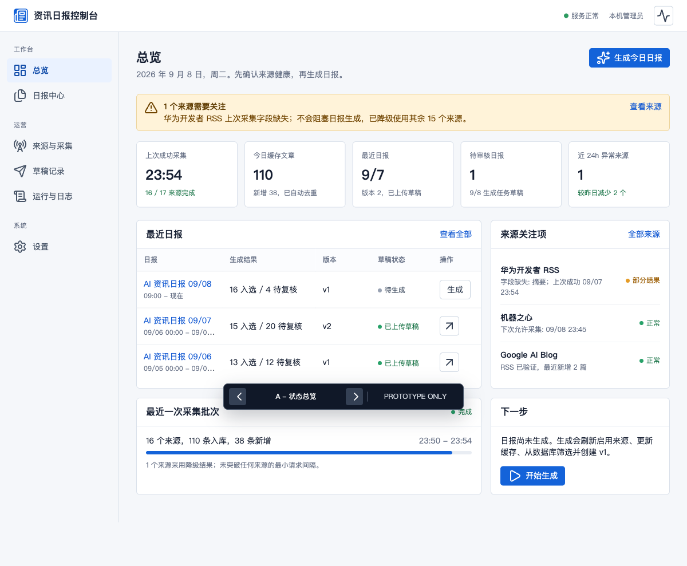
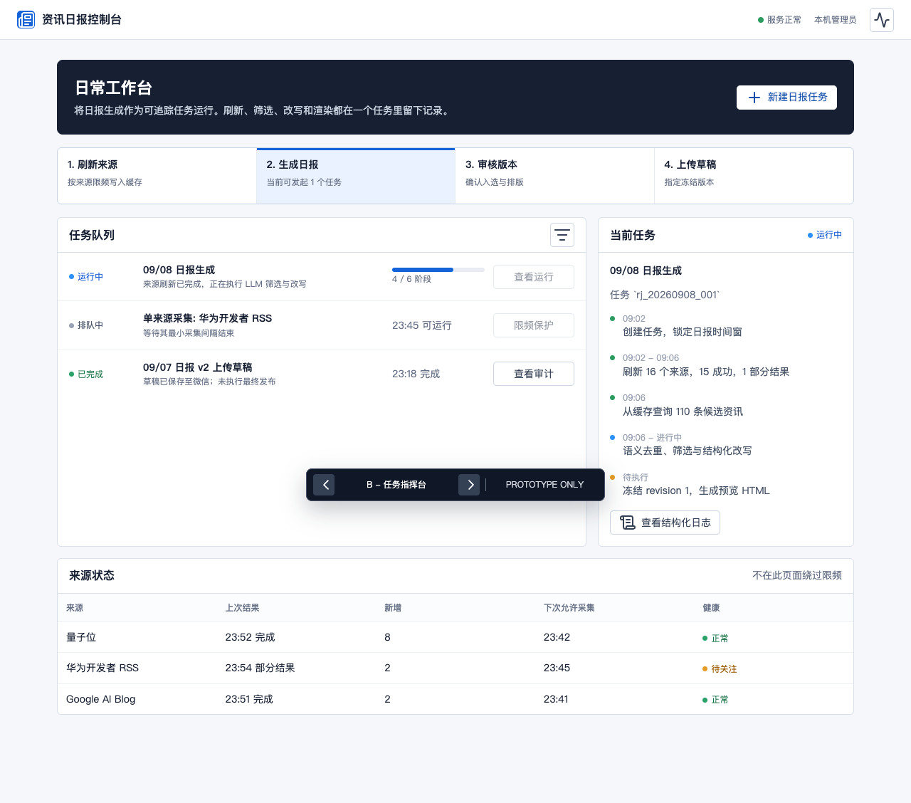
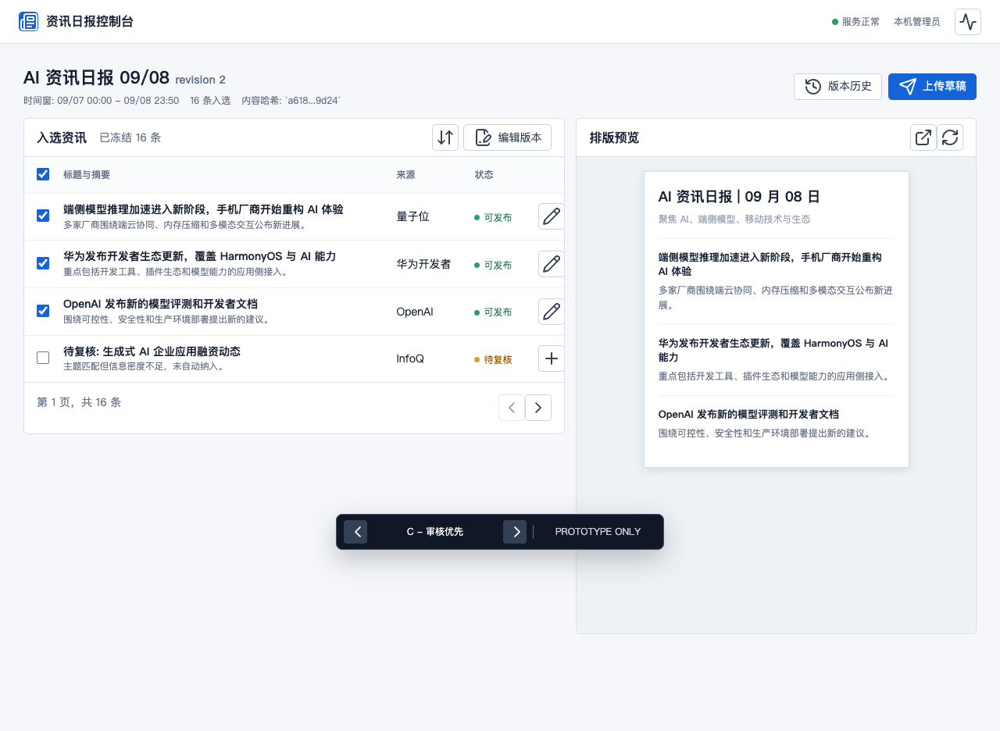

# 资讯日报控制台设计

> 状态：目标设计，尚未实施。本文定义本机“资讯日报控制台”的产品边界、架构、数据契约和开发顺序，供后续开发 Agent 直接执行。

## 1. 背景与目标

当前生产链路已经能完成公开资讯采集、缓存、筛选、MiniMax 改写、HTML 生成和公众号草稿箱上传，但人工操作仍需在终端、目录和多个配置文件之间切换：启动 Collector API、运行 Pipeline、定位 HTML、核对 review 文件，再决定是否上传草稿。

控制台的目标是将这些能力组织为一个本机网页工作流：

```text
来源健康 -> 生成日报 -> 审核并编辑固定版本 -> 预览 -> 上传草稿 -> 公众号后台最终发布
```

它是单人、本机使用的资讯运营后台，不是公开网站，也不是通用爬虫平台。

### 1.1 成功标准

1. 日常使用者无需打开终端或查找目录，即可生成、查看、审核并上传一份日报草稿。
2. 每次日报有独立、可追踪的运行和版本；上传草稿时不得重新采集、重新筛选或重新调用 LLM。
3. 任一来源失败、频控跳过、LLM 失败或草稿上传失败均在页面中可定位到原因、时间和关联任务。
4. 页面操作不绕过 Collector 的来源级限频、幂等、来源适配器和数据库写入边界。
5. 凭证不在浏览器、日志、HTML、导出 JSON 或 URL 中出现。

### 1.2 非目标

- 不恢复或改造已废弃的微信公众号文章抓取、扫码授权或 Docker 链路。
- 不做任意网址“一键爬取”；网页来源仍必须使用经过验证的适配器。
- 第一阶段不做多人协作、云端部署、局域网/公网访问或移动端独立 App。
- 不自动群发给公众号粉丝。当前发布边界是创建微信草稿；最终发布由公众号后台人工完成。
- 不把文章正文、网页 HTML、Cookie 或浏览器 Profile 存入控制台数据库。

## 2. 当前基础与目标边界

| 模块 | 当前能力 | 控制台中的职责 |
| --- | --- | --- |
| `public-source-collector` | 来源目录、公开列表采集、来源限频、SQLite 缓存、健康摘要、Read API | 唯一资讯采集边界；向控制台提供来源状态、采集任务和诊断数据 |
| `ai-news-pipeline` | 刷新缓存、时间窗查询、去重、筛选、LLM 改写、HTML、草稿上传、`news.db` 审计 | 唯一日报生成与草稿上传边界；保存日报、版本、人工编辑和上传审计 |
| 旧 Admin UI | FastAPI、Jinja2、Cookie Session、CSRF 的实现样本 | 可复用鉴权、模板、静态资源与运维交互模式；不得依赖旧微信采集状态 |
| 新控制台 | 尚不存在 | 唯一人工入口，编排两个后端能力，不直接采集网站或直接写 Collector 数据库 |

控制台不替换 Collector 和 Pipeline，而是新增一个 **control plane**。浏览器只调用控制台 API；控制台再调用 Pipeline 应用服务与 Collector API。前端不得直接连接 `collector.db` 或 `news.db`。

## 3. 用户与核心流程

### 3.1 用户角色

第一阶段只有一个本机管理员。为避免误操作，仍必须登录，所有写操作使用 CSRF Token 和审计事件。没有“普通用户”和“管理员”的角色拆分需求。

### 3.2 日常生成与草稿上传



### 3.3 不变量

1. `生成日报` 总是创建一个新的 `report_run`；重复提交同一幂等键返回原任务。
2. 一个 `report_run` 生成至少一个不可变 `report_revision`。人工修改只创建新 revision，不能覆写已上传版本。
3. 上传操作只接受 `revision_id`，不能接受“最新 HTML 路径”或“重新生成后上传”。
4. 上传前进行二次确认，并显示标题、版本号、条目数和 HTML 内容哈希。
5. 一个 revision 的同一草稿上传请求以幂等键保护；重复点击返回已有成功或运行中记录。
6. Collector 的 `SOURCE_INTERVAL_ACTIVE` 是成功保护结果，不是可由控制台绕过的错误。
7. 所有页面预览和历史查看均读取本地冻结版本，不触发采集或 LLM。

## 4. 产品信息架构

控制台监听 `127.0.0.1:4102`，入口为 `http://127.0.0.1:4102/console`。桌面端为固定左侧导航和主工作区；窄屏仅做可读降级，不承诺移动端编辑体验。

```text
总览
日报中心
来源与采集
草稿记录
运行与日志
设置
```

### 4.1 总览 `/console`

用于在一分钟内判断系统状态并开始日常操作。

- 全局状态条：正常、生成中、采集部分降级、需处理失败、服务离线。
- 摘要指标：上次成功采集、上次日报、今日缓存文章数、待审核日报数、最近 24 小时失败来源数。
- 主操作：`生成日报`。点击后打开确认面板，显示时间窗、启用来源数量、当前活跃任务和预计会调用 LLM。
- 最近日报：标题、版本、状态、生成时间、可发布/待复核数量、草稿上传状态，点击进入详情。
- 来源关注项：最多显示 5 个失败、部分结果、过期或异常减量来源。

`生成日报` 在存在运行中的报告任务时禁用，并跳转该任务详情；不允许并发跑两个 Pipeline。

### 4.2 日报中心 `/console/reports`

默认按时间倒序，支持按状态、日期、是否已上传草稿筛选和游标分页。

字段：日报标题、运行时间、时间窗、来源批次状态、候选/入选/可发布/review 数、当前版本、草稿状态、操作。

日报详情 `/console/reports/{report_run_id}` 是核心页面，包含以下页签：

| 页签 | 内容与操作 |
| --- | --- |
| 概览 | 运行时间线、来源健康、各处理阶段计数、稳定原因码、关联 Collector 批次 |
| 入选资讯 | 当前版本的资讯表，可移除、恢复、调整排序、编辑改写标题/摘要/来源说明 |
| 待复核 | 展示未进入当前版本的条目和原因；可手工纳入，纳入后必须填写或确认改写摘要 |
| 排版预览 | 在受限 `iframe` 中渲染冻结 HTML；支持新窗口打开和查看当前 content hash |
| 版本历史 | 每次编辑和上传都形成的版本；可比较版本条目差异、设为当前草稿候选、查看上传记录 |
| 审计 | 只展示此日报的任务、LLM、编辑、渲染和上传事件，不展示敏感请求内容 |

编辑交互采用“编辑草稿 -> 保存新版本 -> 渲染预览”。不会在表格中直接静默改变已经上传的版本。

### 4.3 来源与采集 `/console/sources`

页面面向已支持的公开来源，而非任意 URL：

- 来源名称、类型、启用状态、最小间隔、最近成功、最近结果、数据量基线、当前健康状态。
- `采集全部`、多选采集、单来源采集；提交后进入采集任务详情。
- 显示每个来源的“下次允许采集时间”，频控期间按钮禁用并给出原因。
- 来源详情可见列表入口、适配器种类、最近 endpoint runs、字段缺失摘要和补全尝试。
- 对现有来源只允许启用/暂停。暂停不删除历史缓存。

新增来源分两类：

1. RSS/Atom：可在页面中填写名称、入口、间隔和最大条数，保存后进入“待验证”，必须通过字段完整性验收才可启用。
2. Browser/Browser-network：必须新增代码适配器、测试与显式域名许可；页面仅展示状态，不提供通用 CSS Selector 编辑器。

### 4.4 草稿记录 `/console/drafts`

显示本地 `publish_attempts`，不是从微信后台反向全量同步：

- 对应日报、revision、标题、上传时间、状态、微信 `media_id`、错误原因。
- 成功项可打开对应日报预览，复制 `media_id`，并提供“打开公众号后台”的外链。
- 失败项可查看脱敏错误并以新的幂等键重新上传同一 revision。
- `上传草稿箱` 只能从日报详情的当前 revision 发起；列表页不提供“盲传最新版本”。

### 4.5 运行与日志 `/console/operations`

统一展示报告任务和采集任务，支持按类型、状态、时间和关联 ID 筛选。

- 任务状态、开始/结束、耗时、触发者、结果摘要、原因码。
- 运行中的任务使用 SSE 接收阶段进度；SSE 断线后每 10 秒轮询，终态后停止。
- 日志按事件结构化展示：时间、级别、模块、事件、任务 ID、来源/日报 ID、公开错误摘要。
- 不展示 token、AppSecret、Cookie、HTTP 请求参数、原始响应、文章正文或完整 LLM Prompt。

### 4.6 设置 `/console/settings`

设置页分为“可安全修改”和“仅状态显示”。

可修改：日报时间窗策略、默认启用来源、定时采集时间、来源启停、日报作者、封面图、上传阈值。

仅显示：Collector API 地址、Chrome 可用性、BGE 本地模型状态、MiniMax/公众号凭证“已配置/未配置”、数据库路径、当前版本。密钥不回显，不允许在页面下载配置文件。

## 5. 技术架构

### 5.1 选型

沿用仓库已经验证的技术，避免在本机工具中再引入 Node 构建链和独立服务集群：

| 层 | 选择 | 原因 |
| --- | --- | --- |
| 控制台服务 | FastAPI + Uvicorn | 与 Collector 一致，适合本地 API、SSE 和 Cookie Session |
| 页面 | Jinja2 + 原生 JavaScript + CSS | 复用现有 Admin UI 模式，降低安装与维护成本 |
| 图标 | Lucide | 操作按钮统一使用可识别图标和 tooltip |
| 数据 | Pipeline SQLite `news.db` + Alembic | 日报、版本和上传审计与 Pipeline 同库，保证本地原子性 |
| 后台任务 | SQLite 持久化任务表 + 单 Worker | 支持重启恢复、幂等与可追踪，不引入 Redis/Celery |
| 采集调用 | Collector HTTP API | 不跨边界直连 `collector.db` |
| 服务管理 | macOS `launchd` | API、控制台和每日采集在登录后自动启动 |

第一阶段不采用 React、Electron、Redis、Celery 或 WebSocket。任务实时进度使用 SSE；请求/命令仍是普通 HTTP。

### 5.2 目标组件

```text
Browser
  |
  v  127.0.0.1:4102
News Daily Console (FastAPI)
  |                 |
  |                 +--> Pipeline application service + news.db
  |
  +--> Collector API (127.0.0.1:4100) --> collector.db --> public sources
  |
  +--> WeChat official API (only upload-draft command)
```

控制台服务应放入 `ai-news-pipeline`，因为日报版本、人工编辑与草稿上传属于 Pipeline 域。建议目录：

```text
ai-news-pipeline/
├─ src/
│  ├─ application/
│  │  ├─ report_jobs.py
│  │  ├─ report_revisions.py
│  │  ├─ draft_uploads.py
│  │  └─ console_read_models.py
│  ├─ entrypoints/
│  │  └─ console_app.py
│  ├─ infrastructure/
│  │  ├─ report_repository.py
│  │  └─ collector_console_client.py
│  └─ web/
│     ├─ templates/
│     └─ static/
├─ migrations/
└─ scripts/macos/run_console.sh
```

现有 `run_pipeline` 要重构为可注入的应用服务：它接受 `report_run_id`、冻结时间窗与回调，而不是直接负责 CLI 输出和草稿上传。CLI 和控制台都调用同一服务。

## 6. 数据模型与状态

以下表均在 `ai-news-pipeline/data/news.db` 中，由 Alembic 管理。现有 `runs`、`raw_items`、`processed_items` 暂时保留并以 `pipeline_run_id` 关联，迁移后逐步统一命名。

### 6.1 `report_jobs`

| 字段 | 说明 |
| --- | --- |
| `id` | UUIDv7，任务 ID |
| `job_type` | `generate_report` / `upload_draft` / `collect_sources` |
| `status` | `queued` / `running` / `completed` / `partial` / `failed` / `cancelled` |
| `idempotency_key` | 同类重复提交复用结果 |
| `request_json` | 非敏感参数：时间窗、来源 slug、目标 revision |
| `result_json` | 关联 report、Collector batch、上传结果摘要 |
| `reason_code` / `message` | 稳定错误码和安全摘要 |
| `lease_expires_at` | Worker 崩溃恢复依据 |
| `created_at` / `started_at` / `finished_at` | 生命周期 |

同一时刻只允许一个 `generate_report` 处于 `queued/running`；采集任务与报告生成共用 Collector 的运行锁和来源限频。

### 6.2 `report_runs`

代表一次完整日报生成，而不是一个文件路径。

| 字段 | 说明 |
| --- | --- |
| `id` | UUIDv7 |
| `pipeline_run_id` | 关联旧 Pipeline 审计 run |
| `status` | `generating` / `ready_for_review` / `needs_review` / `uploading` / `draft_uploaded` / `failed` |
| `window_start` / `window_end` | 以 `Asia/Shanghai` 固化的取数时间窗 |
| `collector_batch_id` | 触发的 Collector 刷新批次 |
| `raw_count` / `selected_count` / `publishable_count` / `review_count` | 各阶段计数 |
| `current_revision_id` | 当前可审核或上传版本 |
| `reason_code` / `message` | 失败或降级原因 |
| `created_at` / `finished_at` | 生命周期 |

### 6.3 `report_revisions` 与 `report_revision_items`

`report_revisions` 是不可变快照；每次人工保存或重新渲染产生新 revision。

| 表 | 核心字段 | 说明 |
| --- | --- | --- |
| `report_revisions` | `report_run_id`、`version_number`、`status`、`title`、`html_content`、`content_hash`、`created_by`、`created_at` | 保存可预览、可上传的完整 HTML，不依赖外部文件是否仍存在 |
| `report_revision_items` | `revision_id`、`source_article_id`、`display_order`、`included`、`rewritten_title`、`summary`、`source_label`、`original_snapshot_json` | 保存每个最终条目的冻结来源与人工修改 |

`original_snapshot_json` 仅含标题、摘要、来源、链接、发布时间等既有元数据；不含正文 HTML 或爬虫原始响应。

### 6.4 `publish_attempts`

| 字段 | 说明 |
| --- | --- |
| `id` | UUIDv7 |
| `revision_id` | 唯一上传目标 |
| `idempotency_key` | 防止双击重复建草稿 |
| `status` | `queued` / `running` / `succeeded` / `failed` |
| `wechat_media_id` | 草稿上传成功后的 media ID |
| `content_hash` | 上传时再次记录，证明上传版本 |
| `reason_code` / `message` | 脱敏失败信息 |
| `created_at` / `finished_at` | 审计时间 |

数据库唯一约束：`(revision_id, idempotency_key)`；成功后同一 revision 仍可用新 key 再上传，但 UI 必须先提示已有草稿。

### 6.5 状态转换

```text
report_job queued -> running -> completed/partial/failed
report_run generating -> ready_for_review -> uploading -> draft_uploaded
                              |                 |
                              v                 v
                         needs_review          ready_for_review
report_revision draft -> rendered -> uploaded (uploaded 不可修改)
publish_attempt queued -> running -> succeeded/failed
```

`partial` 只描述来源或处理降级；只有已生成安全 HTML 的报告才进入 `ready_for_review`。Collector 刷新/read API 整体失败时，报告必须 `failed`，不得利用未知状态旧缓存生成新日报。

## 7. 后端接口契约

所有控制台接口使用管理员 Session 鉴权；所有变更请求需 CSRF Token 和 `Idempotency-Key`。返回统一包含 `request_id`，错误形如：

```json
{
  "error": {
    "code": "REPORT_ALREADY_RUNNING",
    "message": "当前已有日报生成任务，请查看正在运行的任务。",
    "request_id": "..."
  }
}
```

### 7.1 读取接口

| 方法 | 路径 | 用途 |
| --- | --- | --- |
| `GET` | `/api/v1/console/overview` | 首页汇总 |
| `GET` | `/api/v1/console/reports` | 日报列表与游标分页 |
| `GET` | `/api/v1/console/reports/{id}` | 日报与当前版本摘要 |
| `GET` | `/api/v1/console/reports/{id}/revisions/{revision}` | 版本、条目、HTML 预览数据 |
| `GET` | `/api/v1/console/sources` | 已注册来源与健康状态 |
| `GET` | `/api/v1/console/sources/{slug}` | 来源详情、最近 endpoint runs |
| `GET` | `/api/v1/console/jobs` | 后台任务列表 |
| `GET` | `/api/v1/console/jobs/{id}` | 任务状态及安全事件 |
| `GET` | `/api/v1/console/events` | 结构化运维事件 |
| `GET` | `/api/v1/console/drafts` | 本地草稿上传审计 |
| `GET` | `/api/v1/console/events/stream` | SSE 增量状态 |

### 7.2 命令接口

| 方法 | 路径 | 请求 | 结果 |
| --- | --- | --- | --- |
| `POST` | `/api/v1/console/reports` | 时间窗、可选来源 | 创建 `generate_report` job，返回 `job_id` |
| `POST` | `/api/v1/console/reports/{id}/revisions` | 条目包含/顺序/人工文本 | 创建新 revision，返回 `revision_id` |
| `POST` | `/api/v1/console/revisions/{id}/render` | 无或显式标题 | 渲染当前 revision 的 HTML 与 hash |
| `POST` | `/api/v1/console/revisions/{id}/drafts` | `confirmation_token` | 创建 `upload_draft` job |
| `POST` | `/api/v1/console/collections` | 空为全量，或 `source_slugs` | 创建 Collector 刷新任务 |
| `PATCH` | `/api/v1/console/sources/{slug}` | `enabled` | 启停现有来源 |
| `POST` | `/api/v1/console/sources/rss` | RSS 配置 | 创建待验证 RSS 来源 |

上传草稿的 `confirmation_token` 由详情页请求，绑定 `revision_id + content_hash + 5 分钟有效期`。HTML 在确认后变更时，令牌失效，前端必须重新预览与确认。

### 7.3 Collector 扩展接口

控制台不能绕开 Collector。需要在 Collector Read API 新增、且继续使用 Pipeline Token 保护的运营接口：

| 方法 | 路径 | 作用 |
| --- | --- | --- |
| `GET` | `/api/v1/ops/sources` | 来源状态、间隔、最近结果、健康摘要 |
| `GET` | `/api/v1/ops/sources/{slug}/runs` | 来源运行与字段拒绝/摘要补全审计 |
| `POST` | `/api/v1/ops/refresh` | 全量或指定来源刷新，复用现有刷新服务 |
| `GET` | `/api/v1/ops/health` | 全局健康和待处理告警 |

来源启停和 RSS 新增的写操作必须由 Collector 的应用服务执行、写入版本化目录或受控配置存储并重新 sync；不允许控制台直接编辑 TOML 文本或 SQLite。

## 8. 任务、并发与失败处理

### 8.1 Worker 模式

控制台服务在 FastAPI lifespan 中启动一个单 Worker 轮询 `report_jobs`，每 2 秒领取一个任务，并每 30 秒更新 lease。重启后，超过 lease 的 `running` 任务标记为 `failed/WORKER_LEASE_EXPIRED`，允许人工用新幂等键重新发起。

任务阶段至少写入：`accepted`、`refreshing_sources`、`reading_cache`、`filtering`、`deduplicating`、`selecting`、`rewriting`、`rendering`、`uploading_draft`、`completed`。页面显示阶段和已完成计数，不伪造百分比。

### 8.2 失败策略

| 场景 | 报告行为 | 页面行动 |
| --- | --- | --- |
| 个别来源 `partial/failed` | 记录降级，继续生成；报告标为 `needs_review` | 显示受影响来源和数量 |
| 所有来源跳过但缓存查询成功 | 允许用符合时间窗的缓存生成，显示“未发起新的网络请求” | 正常审核 |
| Collector API 刷新或查询失败 | 报告失败，不生成新版本 | 查看 Collector 任务与错误 |
| LLM 全局筛选失败 | 报告失败，不生成新版本 | 保留运行审计，允许重试 |
| 单条改写失败 | 进入 review，继续其他条目 | 手工编辑或排除 |
| 上传草稿失败 | revision 保持 `rendered`，报告回到 `ready_for_review` | 查看失败原因，确认后重传同一版本 |
| 草稿上传成功 | revision 变为 `uploaded`，不可再编辑 | 如需修改，复制成新 revision |

### 8.3 审计与日志

每个命令、状态转换、编辑、渲染和上传写入 `console_events`，字段包括 `event_id`、时间、操作者、实体类型/ID、事件名、状态、原因码和安全摘要。系统日志可保留结构化 JSON，但页面以数据库审计为准。

## 9. 安全与发布边界

1. 仅监听 `127.0.0.1`，不得为了远程管理改为局域网或公网监听。
2. 使用管理员密码哈希、签名 Cookie、8 小时闲置过期、CSRF、登录失败限速；复用旧 Admin UI 的成熟模式。
3. `secrets.yaml`、`local-machine.env` 权限保持 `600`；页面只显示“已配置/未配置”。
4. App Secret 和 access token 只能由后端短暂使用；不得写入 `news-config.json` 以外的非受限文件。后续应将草稿工具改为直接接收内存配置，消除该临时文件。
5. 公众号上传仅调用官方草稿接口。`upload_draft` 与“最终发布/群发”必须是不同命令和权限；第一阶段不实现后者。
6. HTML 预览使用 sandboxed iframe，禁止其中脚本访问控制台 Cookie 或父页面。
7. 所有外部链接使用新窗口并带 `rel="noopener noreferrer"`。

## 10. 页面交互与视觉要求

- 这是高频工作工具：页面采用紧凑表格、清晰层级、8px 以下圆角、可扫描的数据密度，不使用营销式 Hero 或多层卡片。
- 操作使用图标或图标+命令文字：生成、预览、打开原文、重试、上传、归档；不以文字胶囊代替常见图标。
- 状态始终使用图标、文本和颜色三者组合；`partial`、`skipped`、`failed` 必须可区分。
- 报告预览与编辑采用左右或上下稳定分栏，不能因日志、标题长度或加载状态改变主要布局。
- 表格默认服务端分页，每页 50 条；搜索有 300ms debounce，筛选状态写入 URL。
- 日志只加载最近 200 条，继续查看用游标；HTML、原始数据和审计详情按需请求。
- 按钮的危险等级清晰：上传草稿须确认对话框；最终发布功能未来若实现，必须有更强显式确认。

### 10.1 可交互设计原型

实现前先用中保真原型确认信息层级与关键操作，而不是直接把第一版页面固化为生产代码：

- [打开控制台交互原型](prototypes/news-daily-console-prototype.html)：通过底部切换条或 URL 参数 `?variant=A|B|C` 查看三种结构；左右方向键也可切换。
- **A - 状态总览**：以“今天是否能顺利生成日报”为中心，适合日常低频操作。它将来源关注项、最近日报和下一步放在同一工作区。
- **B - 任务指挥台**：以持久化任务队列为中心，适合排查采集、LLM 和上传链路中的失败。它强调当前阶段、等待原因与来源级限频。
- **C - 审核优先**：以日报详情、版本和预览为中心，适合编辑完内容后再上传固定版本草稿。

原型只使用固定演示数据，所有按钮均不会发起真实采集、LLM 调用或草稿上传。底部的原型切换条不属于最终产品。截图用于在文档或讨论中快速浏览：







**待确认的产品结论**：推荐以 A 作为控制台首页、B 作为“运行与日志”页面的主布局、C 作为日报详情页的主布局。三者不是互斥的视觉方案，而是三个不同任务的适配布局；确认后应删掉原型代码，并按对应结构正式实现。

## 11. 实施阶段与验收

### Phase A：控制台骨架与可观测性

实现登录、侧边导航、总览、服务健康、报告/采集任务列表和结构化事件读取。此阶段不改变 Pipeline 生成逻辑。

验收：浏览器可完成服务状态检查、查看最近日报、查看来源健康和打开现有 HTML，不需要终端或文件管理器。

### Phase B：持久化日报任务与冻结版本

新增 `report_jobs`、`report_runs`、`report_revisions`、`report_revision_items`、`publish_attempts` 迁移；把 `run_pipeline` 拆为可由 Worker 调用的生成服务。控制台可创建并跟踪“生成日报”，并内嵌预览冻结版本。

验收：一次生成任务即使服务重启也有明确终态；生成后 HTML 和条目快照可从数据库恢复，不依赖输出目录。

### Phase C：人工审核与版本管理

实现移除/恢复、排序、标题摘要编辑、纳入 review 条目、版本差异与重新渲染。

验收：管理员修改一项后产生 revision 2；revision 1 的 HTML、项目和 hash 仍可完整查看。

### Phase D：受控草稿上传

将现有草稿上传改造成 `upload_draft(revision_id)` 服务；增加二次确认、上传审计、封面检查、重复上传防护和草稿历史。

验收：上传成功得到 `media_id`；重复点击不重复创建草稿；上传失败不改变 revision 内容；页面不展示公众号密钥。

### Phase E：来源运营

扩展 Collector 运营 API，完成来源状态、单来源/批量采集、健康和 RSS 待验证接入；维持来源级频控。

验收：手工采集一个来源时页面明确显示 queued/running/skipped/completed/partial/failed，并可定位字段缺失与补全尝试。

### Phase F：本机常驻与回归

新增 `run_console.sh` 和 `launchd` Job，登录后自动启动控制台；补足端到端测试、Playwright 页面验收和恢复测试。

验收：重启 Mac 后访问固定地址即可工作；日常“生成 -> 审核 -> 上传草稿”无需终端；所有既有 CLI 与定时采集仍可运行。

## 12. 开发约束与测试清单

开发 Agent 开始前应阅读：

1. 本文。
2. [PUBLIC_LIST_INGESTION.md](PUBLIC_LIST_INGESTION.md)。
3. [USAGE_GUIDE.md](USAGE_GUIDE.md)。
4. Pipeline 的 `README.md`、`src/pipeline.py`、`src/storage.py`、`src/publisher.py`。

每个阶段至少覆盖：

- 数据迁移升降级和唯一约束。
- 重复 `Idempotency-Key` 不重复生成、采集或上传。
- 同时提交两个日报时只运行一个。
- Worker 中断后的 lease 恢复。
- revision 不可变与 HTML hash 校验。
- 上传只使用指定 revision，不重新调用 Collector 或 MiniMax。
- 上传失败、LLM 失败、Collector 部分失败和来源频控的页面状态。
- 未登录、缺 CSRF、越权接口、敏感字段不出现在 HTML/JSON/日志。
- 桌面与窄屏截图；长标题、空状态、运行中状态不重叠或溢出。

真实采集、真实 MiniMax 调用和真实微信草稿上传只能作为明确人工触发的 smoke test；自动化测试一律使用固定 fixture 和 fake gateway。
