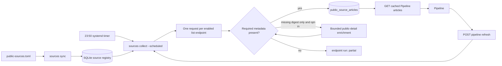

# Public List Ingestion

## Purpose

The active Pipeline path no longer depends on WeChat account sessions or its
internal article-list API. It collects metadata from configured public listing
endpoints and persists only the fields needed by Pipeline:

```text
source / title / digest / canonical URL / published_at / first_seen_at
```

The collector defaults to list metadata only. The production configuration
enables a narrowly bounded detail-enrichment step for explicitly allowlisted
sources: it may open a maximum of three public article pages per endpoint, and
only for rows that already have title, canonical URL
and publish time but lack a summary. It uses Crawl4AI as a non-LLM text cleaner
with `robots.txt` checking; raw Markdown/body content is transient and is
never persisted. A source whose admitted output cannot provide a non-empty
title, summary, link and timezone-aware publish time is marked `partial`;
incomplete entries are not written.

## Flow



`public_collection_runs` is the batch audit record. It stores the trigger and
the selected source slugs, so an on-demand partial refresh is distinguishable
from a full scheduled refresh. Each endpoint has an independent
`public_endpoint_runs` row with fetched, accepted, rejected, new and updated
counts plus a stable reason code. A failed endpoint never prevents the next
endpoint from running.

## Request Boundary

For each enabled endpoint, a run makes one request to `list_url` by default.
With the explicit detail-enrichment switch enabled, it can additionally make
at most three requests to allowlisted public article URLs when the list row lacks
only its digest.
`minimum_interval_seconds` is persisted per endpoint, so a manual rerun inside
that interval becomes `skipped/SOURCE_INTERVAL_ACTIVE`. Scheduled runs use the
idempotency key `public-sources:daily:YYYY-MM-DD`, so duplicate timer firings
reuse the same run. A Pipeline refresh may provide its own idempotency key;
repeating the same key returns the existing audit run rather than issuing a
second set of source requests.

The cache is not a transient report buffer. `public_source_articles` is an
upserted local fact table: items are deduplicated within their source first by
the endpoint's stable source item key and then by canonical URL. Re-observing an existing article can
refresh its approved metadata and records an updated count, but never creates a
second article row. Collection itself does not discard older publication times;
the report's requested time window controls which cached articles are used.

The implementation supports native RSS/Atom and a registry of explicit browser
adapters. A browser source has no generic fallback: it must have a dedicated
list-page selector and extraction contract that proves title, canonical link,
publish time, and summary. Detail enrichment is not such a fallback: it has a
separate per-source domain allowlist and only recovers a missing digest.

## Operations

```bash
cp public-sources.example.toml public-sources.toml
public-source-collector --config collector.toml db upgrade
public-source-collector --config collector.toml sources sync
public-source-collector --config collector.toml sources collect --scheduled
# Refresh only named catalog sources.
public-source-collector --config collector.toml sources collect --source openai --source google-ai
public-source-collector --config collector.toml sources diagnose
public-source-collector --config collector.toml sources health

# `batch_id` is returned by refresh. Pipeline provides it to confirm the
# refresh is complete, then queries the full cache by its report time range.
```

Install the optional dependency only on deployments that deliberately enable
`[detail_enrichment]`: `pip install -e '.[detail-enrichment]'`. A successful
enrichment persists `digest_source=detail`; every success and failure is
recorded in `public_article_enrichment_attempts` with source URL, method,
duration, reason code and linked article ID when one was written. `sources
diagnose` returns those records alongside each endpoint's field acceptance
counts. The collector never stores detail HTML, Markdown, screenshots, cookies
or browser profiles in the article data.

The default browser mode is `headless`. InfoQ AI Briefs is explicitly marked
as requiring a normal visible session, so its dedicated adapter opens Chrome
with the collector's own persistent profile even while other browser sources
continue headlessly. This is a rendering-compatibility choice, never an
attempt to copy cookies or bypass access controls.

Install and enable `deploy/systemd/public-sources-collect.timer` to run near
23:50 each day. The API command now serves `PublicReadModel` with
`schema_version: "2.1"`; article records include `source`; the old `account`
object is retained temporarily as a compatibility alias for consumers that
have not switched to `source.name`.

## Pipeline Contract

Every daily report follows this order: refresh the source cache, query the
cache for the report's business time window, then perform the Pipeline's own
cross-source deduplication, relevance filtering and rewriting. The reporting
pipeline must not fetch public sites directly. For example, a report started on
July 9 may query the complete July 8 and July 9 window after refresh; articles
are not dropped merely because they were collected before the report began.

```bash
# Empty source_slugs means all enabled catalog sources.
curl -X POST http://127.0.0.1:4100/api/v1/pipeline/refresh \
  -H "Authorization: Bearer $PUBLIC_SOURCE_COLLECTOR_PIPELINE_TOKEN" \
  -H 'Content-Type: application/json' \
  -d '{"idempotency_key":"pipeline-daily:2026-08-08"}'

# A manual or recovery refresh may deliberately target selected sources.
curl -X POST http://127.0.0.1:4100/api/v1/pipeline/refresh \
  -H "Authorization: Bearer $PUBLIC_SOURCE_COLLECTOR_PIPELINE_TOKEN" \
  -H 'Content-Type: application/json' \
  -d '{"source_slugs":["openai","google-ai"],"idempotency_key":"pipeline-retry:2026-08-08:1"}'

curl -G http://127.0.0.1:4100/api/v1/pipeline/articles \
  -H "Authorization: Bearer $PUBLIC_SOURCE_COLLECTOR_PIPELINE_TOKEN" \
  --data-urlencode 'published_from=2026-08-07T00:00:00+08:00' \
  --data-urlencode 'published_before=2026-08-09T00:00:00+08:00' \
  --data-urlencode 'limit=500'
```

`POST /api/v1/pipeline/refresh` executes a single bounded collection run and
returns its audit result. `source_slugs` is optional; when supplied every slug
must name an enabled catalog source or the request fails without collecting.
`GET /api/v1/pipeline/articles` accepts repeated `source_slugs` query values
for an optional cached-source filter, retains cursor pagination, and never
causes a network request.

## Source Admission Rule

Before enabling a new endpoint, run it repeatedly against a disposable
database and verify all of the following:

1. Only the configured listing URL is requested.
2. Every persisted item has title, digest, canonical URL and `published_at`.
3. A second run produces zero duplicates for the same list items.
4. `public_endpoint_runs` makes empty, partial and failed outcomes visible.
5. The source's first-seen delay is suitable for the report schedule.
6. If detail enrichment is admitted, its canonical article host is in the
   explicit allowlist, `robots.txt` permits access, and the list row is still
   rejected when no short summary can be derived.

The sample catalog enables sources only after their dedicated adapter has
passed the rule. Candidates without a complete list-level contract stay
disabled rather than falling back to a broad HTML scraper.

## Current Source Matrix

The Pipeline does not classify these sources by topic; it ingests broad,
authoritative lists and leaves AI, on-device model, mobile technology and
mobile ecosystem filtering to the reporting Pipeline.

| Source | Listing entry | Current status |
| --- | --- | --- |
| 爱范儿 | `https://www.ifanr.com/feed` | **Enabled** native RSS; one list request yielded 20 complete items. |
| 新智元 | `https://aiera.com.cn/` | **Enabled** dedicated entry-card adapter; latest validation returned 10 complete items. |
| Android Developers | `https://developer.android.com/blog/` | **Enabled** dedicated post-list adapter; entries without all required list fields are rejected. |
| Apple Developer News | `https://developer.apple.com/news/` | **Enabled** dedicated news-section adapter. |
| Google AI | `https://blog.google/technology/ai/rss/` | **Enabled** native RSS; validated with complete title, summary, canonical URL and publication time. |
| OpenAI News | `https://openai.com/news/rss.xml` | **Enabled** native RSS; validated with complete title, summary, canonical URL and publication time. |
| InfoQ AI Briefs | `https://www.infoq.cn/aibriefs` | **Enabled** dedicated adapter. It uses a visible, dedicated Chrome profile because the public page is not reliably rendered in a headless session; it collects title, summary, original link and publication time only. |
| 虎嗅 AI 资讯 | `https://www.huxiu.com/ainews/` | **Enabled** dedicated Nuxt list-data adapter. It uses a visible dedicated Chrome profile and fails with `LIST_ACCESS_BLOCKED` when the public page presents a verification screen; the failure is isolated to this endpoint. |
| 量子位 | `https://www.qbitai.com/tag/ai` | **Enabled** dedicated card adapter. Some cards without a usable summary or date are rejected by the required-field gate. |
| AIBase 新闻 | `https://news.aibase.com/zh/news` | **Enabled** dedicated grid-card adapter. It accepts only rows with title, summary, official link and parseable list time. |
| 机器之心 | `https://www.jiqizhixin.com/articles/` | Enabled: a dedicated browser-network adapter loads only the public article-list page and accepts JSON only when that page itself requests `/api/article_library/articles.json`. It fails closed when no matching response is observed, with no direct-API fallback. The observed response currently returns only the newest 20 items even when a higher `per` value or `page=2` is requested. |
| 智东西 | AI category list | **Enabled** dedicated card adapter. `MM-DD` list dates are normalized to a UTC timestamp; cards with placeholder-only summaries are rejected. |
| HarmonyOS 开发者 | `https://developer.huawei.com/consumer/cn/information/news` | Disabled: the page itself requests a lightweight list JSON with title, introduction, date, cover, and `informationId`, but neither the response nor DOM exposes a per-item official article URL. |
| 字节 Seed | `https://seed.bytedance.com/zh/blog` | Disabled: no article-list XHR/fetch is observed; the rendered cards expose title and date but not verified per-item canonical URLs. |
| 千问 Research | `https://qwen.ai/research` | **Enabled** browser-network adapter: the page itself requests the article list. The response carries full HTML, but the adapter retains only title, official route, `extra.introduction`, date and cover; raw article HTML is discarded. |
| 通义 | `https://tongyi.aliyun.com/news` | Disabled: the public page currently returns HTTP 500 before a list can render. |
| 豆包研究 | `https://research.doubao.com/zh/blog` | Disabled: it currently renders the same Seed blog listing and likewise has no article-list XHR/fetch or verified per-item canonical URLs. |
| 字节技术团队 | `https://developer.volcengine.com/user/2772312065061673` | Disabled: no article-list XHR/fetch is observed; the rendered page exposes the profile link but no per-item article URLs. |

The disabled entries remain in the catalog as an audited discovery backlog, but
do not produce requests in scheduled runs. Enabling one requires a public page
flow that passes the source admission rule. When source-specific enrichment is
necessary, it must retain only the derived metadata/summary and discard raw
detail content before persistence.
